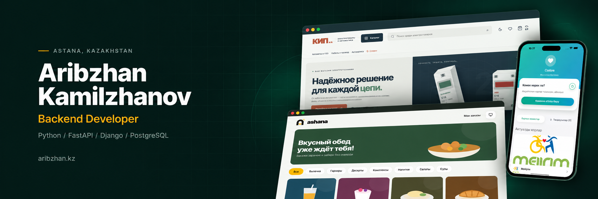
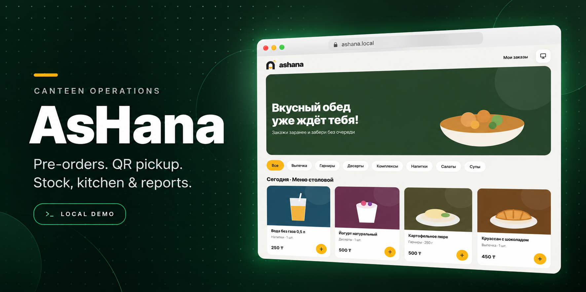
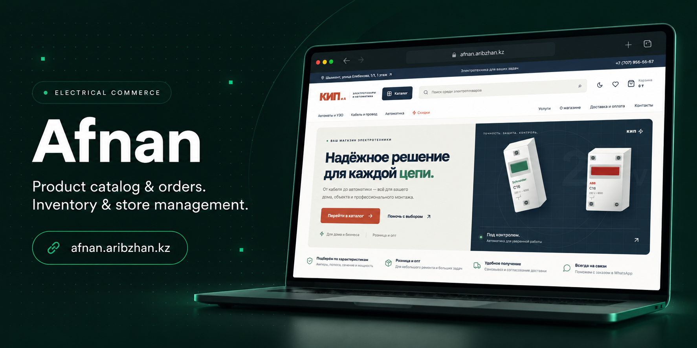
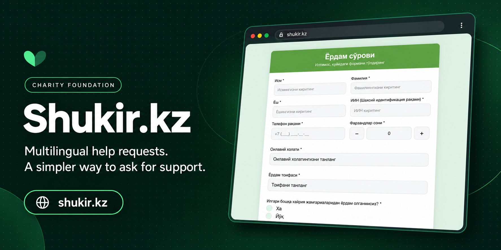
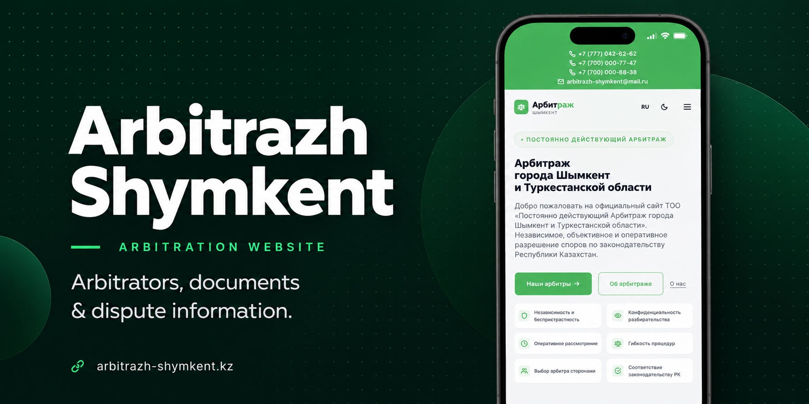
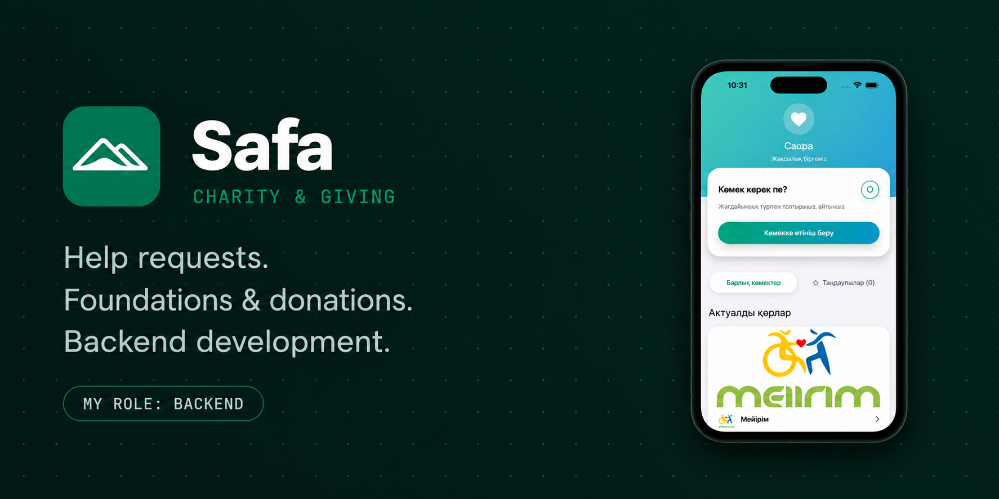
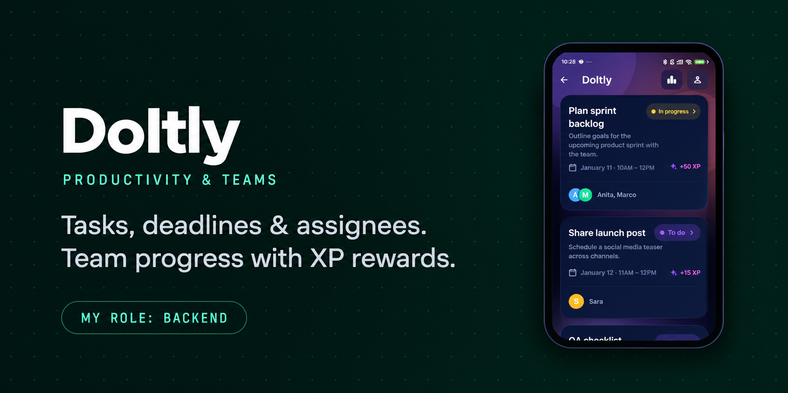

  

  
  
  

 

I build **Python backends and web products** — APIs, business workflows and the interfaces that bring them to users. My work spans charity platforms, business websites, commerce and tools for everyday operations.

My main focus is **FastAPI, Django and PostgreSQL**. I also work with React and TypeScript, connect real-time features with WebSockets, and deploy applications with Docker, Nginx and Linux.

Based in **Astana, Kazakhstan**. Open to projects and collaboration.

 

## Selected work

<table>
  <tr>
    <td width="50%" valign="top">
      
      <h3>AsHana</h3>
      
A canteen pre-order and operations system. Guests choose meals and collect orders by QR code; staff manage the kitchen, counter sales, stock, reports and payroll in one workspace.

      
Shared inventory, transactional reservations and live WebSocket updates connect the ordering experience to day-to-day operations.

      
<code>FastAPI</code> <code>PostgreSQL</code> <code>React</code> <code>TypeScript</code> <code>Docker</code>

      
<b>Local demo · simulated payments</b>

      
<a href="https://github.com/aribzhan-dev/AsHana">Source &amp; overview</a> · <a href="https://github.com/aribzhan-dev/AsHana/blob/main/docs/engineering/quick-start.md">Run the demo</a>

    </td>
    <td width="50%" valign="top">
      
      <h3>Afnan · КИП и А</h3>
      
A storefront and management system for an electrical goods shop in Shymkent. It brings product discovery, ordering, inventory and catalog administration into one application.

      
The backend calculates order totals and reserves stock transactionally; the admin workspace manages products and order statuses.

      
<code>FastAPI</code> <code>SQLite</code> <code>React</code> <code>TypeScript</code>

      
<b>Deployed website</b>

      
<a href="https://afnan.aribzhan.kz">Live site</a> · <a href="https://github.com/aribzhan-dev/afnan">Source</a>

    </td>
  </tr>
  <tr>
    <td width="50%" valign="top">
      
      <h3>Shukir.kz</h3>
      
A charity foundation website with Uzbek, Kazakh and Russian interfaces. People can submit assistance requests, select the type of help they need and attach supporting documents.

      
A practical digital entry point for collecting requests in one structured workflow.

      
<code>Python</code> <code>Django</code> <code>Multilingual web</code>

      
<b>Deployed website</b>

      
<a href="https://shukir.kz">Live site</a>

    </td>
    <td width="50%" valign="top">
      
      <h3>Arbitrazh Shymkent</h3>
      
A public website for the permanent arbitration institution of Shymkent and the Turkestan region. Visitors can find arbitrator profiles, dispute categories, institutional information and downloadable documents.

      
Clear navigation makes the institution's services and contact information easy to reach.

      
<code>Business website</code> <code>Document access</code> <code>Responsive UI</code>

      
<b>Deployed website</b>

      
<a href="https://arbitrazh-shymkent.kz">Live site</a>

    </td>
  </tr>
  <tr>
    <td width="50%" valign="top">
      
      <h3>Safa</h3>
      
A Kazakh-language charity and sadaqa app bringing help requests, foundations and donation collections into one feed.

      
<b>My contribution: backend development.</b> A collaborative mobile project; the app overview and interface reference are from <a href="https://github.com/DevZair">DevZair</a>.

      
<code>Backend API</code> <code>Charity platform</code> <code>Team project</code>

      
<a href="https://github.com/DevZair/Safa.app">Mobile app repository</a>

    </td>
    <td width="50%" valign="top">
      
      <h3>DoItly</h3>
      
A team task manager with deadlines, assignees, progress tracking and an XP-based productivity experience.

      
<b>My contribution: backend development.</b> My API implements authentication, companies, users and task workflows. The mobile overview and interface reference are from <a href="https://github.com/DevZair">DevZair</a>.

      
<code>FastAPI</code> <code>SQLAlchemy</code> <code>PostgreSQL</code>

      
<a href="https://github.com/aribzhan-dev/doltly-backend">My backend</a> · <a href="https://github.com/DevZair/DoItly_app">Mobile app</a>

    </td>
  </tr>
</table>

Project cards are AI-generated presentation visuals based on project interface references. Follow the links for the websites and source repositories.

 

### Personal portfolio · [aribzhan.kz](https://aribzhan.kz)

My own website brings together selected work, technical skills, experience and contact details.

[Live site](https://aribzhan.kz) · [Frontend](https://github.com/aribzhan-dev/portfolio-frontend) · [Backend](https://github.com/aribzhan-dev/portfolio-backend)

 

## Toolbox

| Area | Technologies |
| :--- | :--- |
| **Backend** | Python · FastAPI · Django · Django REST Framework · REST APIs · WebSockets |
| **Data** | PostgreSQL · SQLite · MySQL · Redis |
| **Frontend** | React · TypeScript · JavaScript · HTML · CSS · Tailwind CSS |
| **Delivery** | Docker · Nginx · Linux · Git · GitHub Actions |

 

## Let's build something useful

Have a product to launch, an API to build or a workflow to automate? Let's talk.

**[Portfolio](https://aribzhan.kz)** &nbsp; / &nbsp; **[Telegram](https://t.me/aribzhan_dev)** &nbsp; / &nbsp; **[Email](mailto:aribzankamilzanov@gmail.com)**
